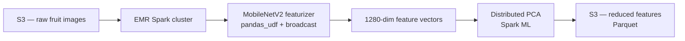

# 🍎 Fruits Image Classification — Distributed Feature Extraction on AWS EMR

> A scalable PySpark pipeline that extracts image features with MobileNetV2 and reduces them with distributed PCA, running on an AWS EMR Spark cluster with S3 storage.

**Stack:** `PySpark` · `TensorFlow / Keras` · `AWS EMR` · `AWS S3` · `MobileNetV2` · `Python`  |  **Status:** completed  |  **Year:** 2023

> 🇫🇷 *Version française plus bas — [aller à la version FR](#-version-française).*

---

## 1. Context & Problem

A fictional AgriTech startup wants a mobile app that recognizes fruits from a photo. Before the app exists, the data pipeline has to prove it can scale: thousands of images, growing daily, that no single machine should process. The question for this project — build a **feature-extraction pipeline that runs distributed from day one**, so the volume can grow without re-architecting everything later.

## 2. Method & Tools

The pipeline runs on a managed Spark cluster (AWS EMR) reading from and writing to S3. Images are featurized with a pretrained **MobileNetV2** (ImageNet weights, classification head removed), producing a 1280-dimension vector per image. Feature extraction is distributed across the cluster with a Spark `pandas_udf`, and the model weights are shared to every worker with a Spark **broadcast** to avoid reloading. Dimensionality is then reduced with a **distributed PCA** on Spark ML.

## 3. Pipeline / Schema



## 4. What Was Done

- Provisioned an **AWS EMR** cluster with Spark, configured S3 access and a bootstrap script for Python dependencies.
- Loaded images from S3 as a Spark DataFrame (binary files).
- Loaded **MobileNetV2** without its top layer and **broadcast** the weights to all workers.
- Built a `pandas_udf` to run inference per partition and output a 1280-dim feature vector per image.
- Applied **StandardScaler** then **PCA** (Spark ML) to compress the feature space.
- Wrote the results back to **S3 as Parquet**.

## 5. Results

- **688 images** processed end-to-end through the distributed pipeline.
- **1280 → 400 dimensions** after PCA (`n_components = 400`), reducing storage and downstream compute while keeping most of the variance.
- **PCA: 400 components → 92% of variance retained** (vs. 95% at 600, 60% at 50) — a deliberate trade-off, not a default.
- **8× faster on the cluster**: feature extraction ran in **5 min on EMR vs. 42 min locally**.
- Features and PCA output persisted as **Parquet on S3**, ready for a downstream classifier.
- Pipeline validated on EMR — the same code scales from a local test to the cluster with no change.

## 6. Impact

- **8× faster** feature extraction on the cluster (42 min local → 5 min on EMR).
- **−69% feature size** (1280 → 400 dims) while keeping **92% of the variance** → cheaper storage and downstream training with almost no signal lost.
- **Zero code change** between local test and cluster run → faster path from prototype to scale.
- **Horizontally scalable by design** → the dataset can grow by orders of magnitude without re-architecting the data layer.

> This was an academic project on a public dataset, so the impact is technical (scalability, compute saved), not financial. For client work the same section would report € saved / hours saved / errors avoided.

## 7. Interpretation

Running inference inside a `pandas_udf` with broadcast weights is what makes the pipeline scale: the model loads once per worker, not once per image. PCA at 400 components keeps the signal while cutting the feature size by ~69%, which matters as soon as the dataset grows beyond a few hundred images.

## 8. Conclusion

A working, cloud-native feature-extraction pipeline that scales horizontally — the foundation a classifier or a mobile backend can be built on without reworking the data layer.

## 9. Limits & Critical Review

- Validated on 688 images — the real test is a dataset 100× larger; the architecture supports it but it wasn't measured here.
- No downstream classifier yet: the pipeline stops at reduced features.
- Variance retained by PCA should be reported explicitly to justify the 400-component choice.
- EMR cost/runtime trade-offs (cluster size vs. speed) were not benchmarked.

## 10. Improvements & TODO Next

- [ ] Report explained variance and tune `n_components` from it.
- [ ] Add a classifier (e.g. Spark ML or a downstream Keras head) on the reduced features.
- [ ] Benchmark on the full Fruits-360 dataset (~90k images) and record cluster timings/cost.
- [ ] Parameterize bucket names and cluster config instead of hardcoding.
- [ ] Package the setup as infrastructure-as-code (EMR via Terraform/CloudFormation).

---

## 🗂️ Repository structure

```
p8-fruits-pyspark-aws/
├── README.md
├── TEMPLATE.md              # reusable project template
├── requirements.txt
├── .gitignore
├── notebooks/
│   └── p8_fruits_pyspark_aws.ipynb
└── docs/
    ├── aws_setup.md         # EMR / S3 setup walkthrough (no secrets)
    └── presentation.pdf     # project defense slides (32 pages)
```

📑 **Slides:** [`docs/presentation.pdf`](docs/presentation.pdf) — the project walkthrough presented for the defense.

## 📦 Data

This project uses the public **[Fruits-360 dataset](https://www.kaggle.com/datasets/moltean/fruits)** (Kaggle). Images are **not** stored in this repo — download them and upload to your own S3 bucket. Update the bucket path in the notebook before running.

## ▶️ Run

```bash
pip install -r requirements.txt
# then open notebooks/p8_fruits_pyspark_aws.ipynb on your EMR cluster
```
See [`docs/aws_setup.md`](docs/aws_setup.md) for the EMR + S3 setup.

---

# 🇫🇷 Version française

## 1. Contexte & Problème
Une startup AgriTech fictive veut une app mobile qui reconnaît les fruits à partir d'une photo. Avant même l'app, le pipeline de données doit prouver qu'il passe à l'échelle : des milliers d'images, en croissance quotidienne, qu'aucune machine seule ne devrait traiter. L'objectif du projet — construire un **pipeline d'extraction de features distribué dès le départ**, pour absorber le volume sans tout ré-architecturer plus tard.

## 2. Méthode & Outils
Le pipeline tourne sur un cluster Spark managé (AWS EMR) qui lit et écrit sur S3. Les images sont vectorisées par un **MobileNetV2** pré-entraîné (poids ImageNet, tête de classification retirée), produisant un vecteur de 1280 dimensions par image. L'extraction est distribuée sur le cluster via un `pandas_udf` Spark, et les poids du modèle sont partagés à chaque worker par un **broadcast** Spark pour éviter de les recharger. La dimension est ensuite réduite par une **PCA distribuée** (Spark ML).

## 3. Pipeline / Schéma
Voir le diagramme Mermaid ci-dessus (S3 → EMR → MobileNetV2 → PCA → S3 Parquet).

## 4. Ce qui a été fait
- Provisionnement d'un cluster **AWS EMR** avec Spark, accès S3 et script bootstrap pour les dépendances Python.
- Chargement des images depuis S3 en DataFrame Spark.
- Chargement de **MobileNetV2** sans sa couche finale, **broadcast** des poids à tous les workers.
- `pandas_udf` pour l'inférence par partition → vecteur de 1280 dimensions par image.
- **StandardScaler** puis **PCA** (Spark ML) pour compresser l'espace des features.
- Écriture des résultats sur **S3 au format Parquet**.

## 5. Résultats
- **688 images** traitées de bout en bout.
- **1280 → 400 dimensions** après PCA (`n_components = 400`), moins de stockage et de calcul en aval.
- **PCA : 400 composantes → 92 % de variance conservée** (vs 95 % à 600, 60 % à 50) — un arbitrage assumé, pas une valeur par défaut.
- **8× plus rapide sur le cluster** : extraction des features en **5 min sur EMR contre 42 min en local**.
- Features et sortie PCA persistées en **Parquet sur S3**, prêtes pour un classifieur.
- Pipeline validé sur EMR — le même code passe du test local au cluster sans modification.

## 6. Impact
- **8× plus rapide** pour l'extraction des features sur le cluster (42 min en local → 5 min sur EMR).
- **−69 % de taille de features** (1280 → 400 dims) tout en gardant **92 % de la variance** → stockage et entraînement en aval moins coûteux, presque sans perte de signal.
- **Zéro changement de code** entre le test local et le cluster → du prototype à l'échelle plus vite.
- **Scalable horizontalement par conception** → le dataset peut grossir d'un facteur 100 sans ré-architecturer la couche données.

> Projet académique sur un dataset public : l'impact est technique (scalabilité, calcul économisé), pas financier. Pour une mission client, cette section rapporterait des € économisés / heures gagnées / erreurs évitées.

## 7. Interprétation
L'inférence dans un `pandas_udf` avec poids broadcastés, c'est ce qui fait tenir l'échelle : le modèle se charge une fois par worker, pas une fois par image. La PCA à 400 composantes garde le signal tout en réduisant la taille des features d'environ 69 %, ce qui devient critique dès que le dataset grossit.

## 8. Conclusion
Un pipeline d'extraction de features cloud-native, fonctionnel et scalable horizontalement — la fondation sur laquelle un classifieur ou un backend mobile peut se construire sans retoucher la couche données.

## 9. Limites & Regard critique
- Validé sur 688 images — le vrai test, c'est un dataset 100× plus grand ; l'archi le permet mais ça n'a pas été mesuré.
- Pas encore de classifieur en aval : le pipeline s'arrête aux features réduites.
- La variance expliquée par la PCA devrait être rapportée pour justifier le choix de 400 composantes.
- Les arbitrages coût/temps EMR (taille cluster vs vitesse) n'ont pas été benchmarkés.

## 10. Améliorations & TODO Next
- [ ] Rapporter la variance expliquée et régler `n_components` à partir de là.
- [ ] Ajouter un classifieur sur les features réduites.
- [ ] Benchmarker sur le Fruits-360 complet (~90k images) avec temps/coût cluster.
- [ ] Paramétrer les noms de buckets et la config cluster au lieu de les coder en dur.
- [ ] Packager le setup en infrastructure-as-code (EMR via Terraform/CloudFormation).

---

<sub>Built under <b>AnastatsIA</b> · OpenClassrooms Data Scientist — Project 8 · standardized project format</sub>
