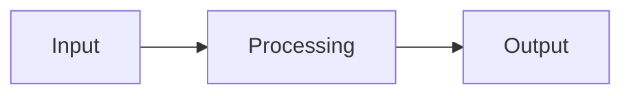

<!--
  AnastatsIA — Standard project README template.
  Copy this file to README.md for any new project and fill each section.
  The structure follows a scientific-report logic so any reader can navigate
  any project, regardless of the topic.
-->

# <Project Title>

> One-line pitch — what it does, in plain words.

**Stack:** `tool` · `tool` · `tool`  |  **Status:** completed / in-progress  |  **Year:** YYYY

---

## 1. Context & Problem
*The "why". The business or scientific need. What question are we answering?*

## 2. Method & Tools
*The technical stack and the overall approach.*

## 3. Pipeline / Schema
*A visual of the workflow (Mermaid diagram preferred).*

## 4. What Was Done
*The concrete steps actually performed.*

## 5. Results
*Numbers, outputs, metrics. Lead with the figures.*

## 6. Interpretation
*What the results mean.*

## 7. Conclusion
*The take-away, in two lines.*

## 8. Limits & Critical Review
*Honest look at what falls short.*

## 9. Improvements & TODO Next
*What we would do with more time.*

---

AnastatsIA · standardized project format
